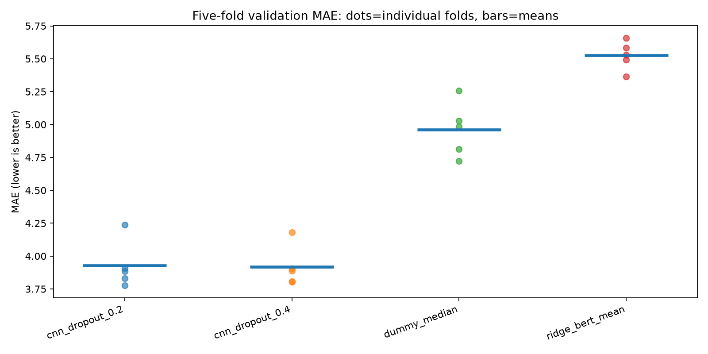
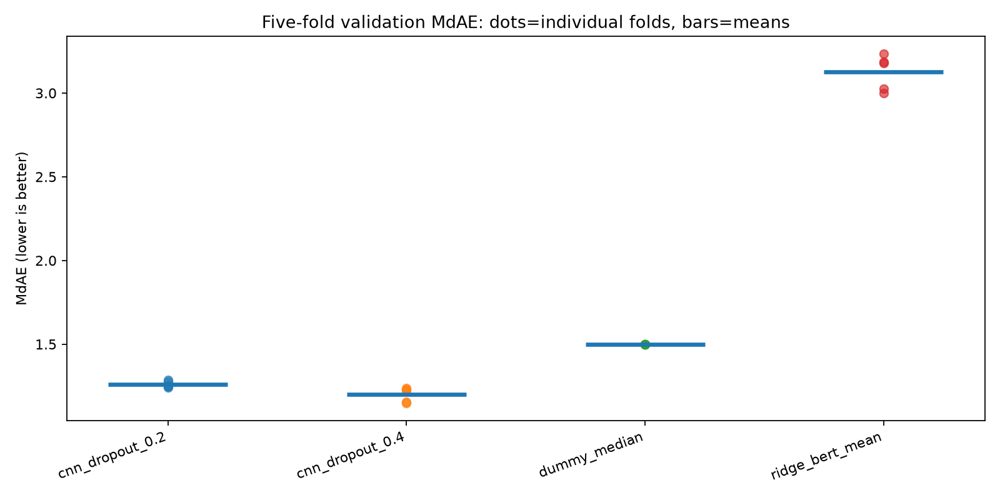
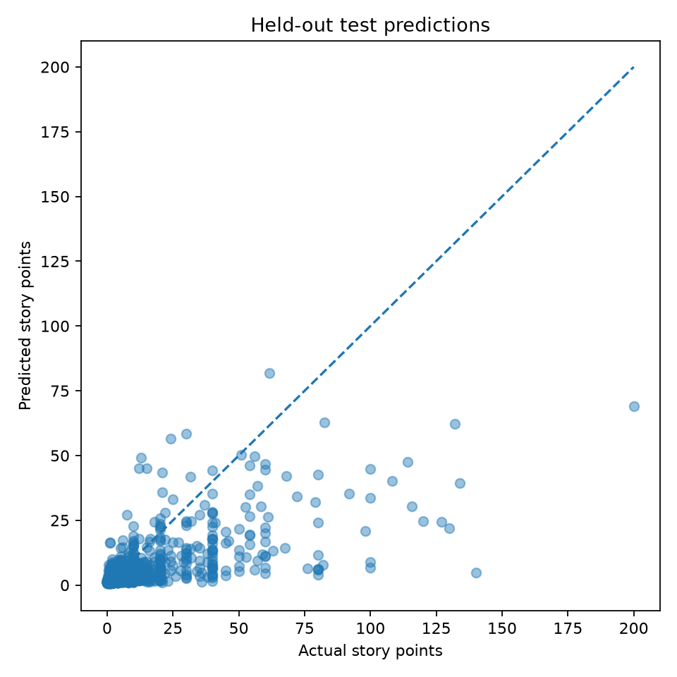
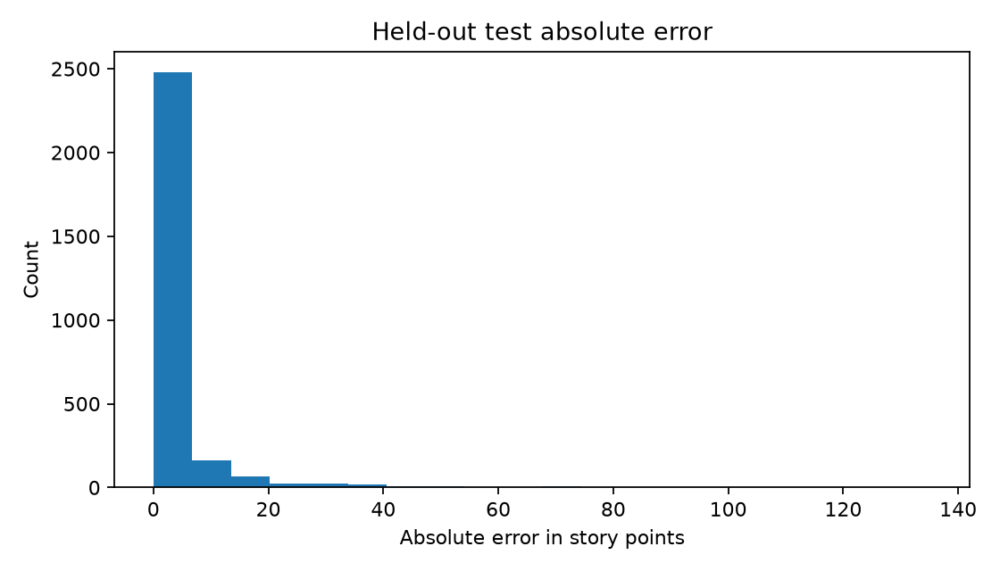
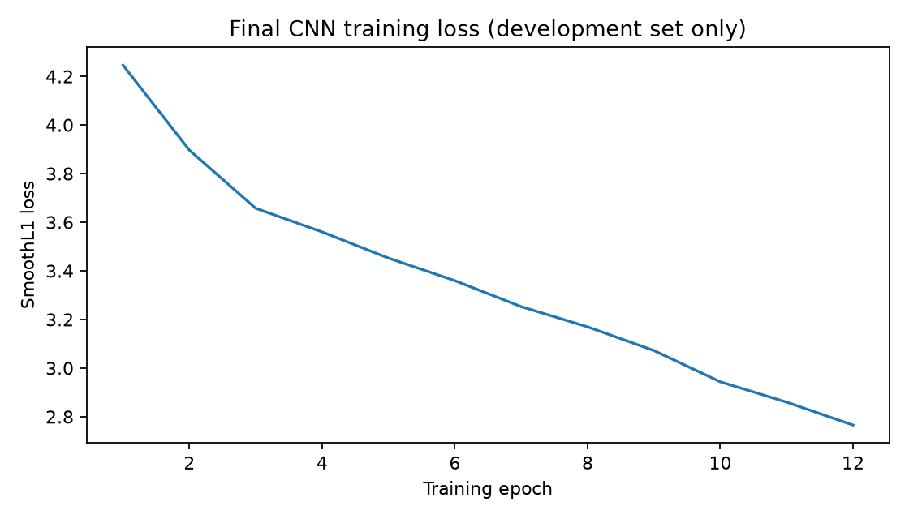

# BERT-Based Word Embeddings for Within-Project Software Story Point Estimation

**Project Statement 1 (PS-1) | Natural Language Processing**

**Group:** Group 2  
**Members:** Aditya Sunil Menon, Athul Anil Kumar, Johan John Koshy, Kiran Nambiar, Mohammed Omar  
**GitHub repository:** https://github.com/R2D2-08/nlptawos  
**Project data:** DM (TAWOS v1.1)

## Abstract

In this project we evaluated contextual BERT token representations for predicting software story points using a random within-project split on the DM project. What we experimented on reserved 2813 of 14061 eligible issues for final testing and ran five-fold cross-validation on the development set. The token embeddings were produced by a frozen pretrained BERT encoder for a three-layer convolutional regression head. The final chosen CNN obtained held-out MAE 3.9559 and MdAE 1.1618. The constant-median baseline yielded MAE 5.1337 and MdAE 1.3000. Detailed validation and test results are presented separately.

## 1. The problem at hand

How effectively do BERT-based contextual token embeddings predict story point values from the title and description of an issue, when training and testing use distinct issues from the same project under a random split? This is an example of supervised numerical regression.

## 2. Methodology, Data collection and preprocessing

Dataset: Tawosi et al., TAWOS v1.1 (DOI 10.5522/04/21308124). The official database is MySQL; the extractor joins Issue and Project, using Title and Description_Text as input and Story_Point as the target. Issues explicitly changed after estimation, empty texts, invalid labels, and repeated exact descriptions are filtered. Unknown change flags remain a potential limitation.

| Audit stage | Count |
| --- | --- |
| Source issues with project key | 20065 |
| Positive numeric labels | 20065 |
| After explicit edit filtering | 14365 |
| Final distinct cleaned issues | 14061 |
| Development data (80%) | 11248 |
| Final held-out test (20%) | 2813 |

## 3. Architecture 

Pretrained google-bert/bert-base-uncased, frozen and used for contextual token features. Text is tokenized with padding/truncation at 64 tokens. The token features feed Conv1d layers with [128, 64, 32] output channels, kernel size 3, ReLU and masked mean pooling; a dense head predicts story points. Fixed-epoch training uses SmoothL1 loss, AdamW learning rate 0.0007, weight decay 0.01, batch size 32, epochs 12, seed 42.

## 4. Validation protocol and selection

The final test set is isolated before model development. Five folds of the 80% development set each take a turn as validation data. CNN dropout candidates are chosen by lowest mean validation MAE, with mean MdAE as tie-breaker. The chosen CNN is refitted on all development examples and evaluated once on the untouched held-out test. Baselines are constant training median and Ridge regression on average BERT token features.

## 5. Five-fold validation results

| Model | MAE mean +/- SD | MdAE mean +/- SD |
| --- | --- | --- |
| cnn_dropout_0.2 | 3.9274 +/- 0.1804 | 1.2608 +/- 0.0188 |
| cnn_dropout_0.4 | 3.9173 +/- 0.1534 | 1.1992 +/- 0.0425 |
| dummy_median | 4.9608 +/- 0.2071 | 1.5000 +/- 0.0000 |
| ridge_bert_mean | 5.5256 +/- 0.1093 | 3.1252 +/- 0.1052 |

The selected CNN setting based on development cross-validation was `cnn_dropout_0.4`. Individual fold observations are saved in `five_fold_results.csv`.

## 6. Final held-out test results (obtained by separate evaluation)

| Model | MAE | MdAE |
| --- | --- | --- |
| cnn_dropout_0.4 | 3.9559 | 1.1618 |
| ridge_bert_mean | 5.4835 | 3.0918 |
| dummy_median | 5.1337 | 1.3000 |

## 7. Findings

The selected CNN MAE (3.9559) is lower than the constant-median baseline MAE (5.1337). The BERT-mean Ridge comparison has held-out MAE 5.4835.

### Five-fold validation MAE

### Five-fold validation MdAE

### Actual versus predicted story points

### Held-out absolute errors

### Final CNN training loss

## 8. Limitations and threats to validity

- Within-project estimates may not transfer to other projects with different jargon and story point scales.
- Story points are subjective and noisy.
- Frozen BERT is not software-domain fine-tuned, and token truncation may omit important issue details.

## 9. Conclusion

In this observed within-project experiment, cnn_dropout_0.4 obtained a held-out MAE of 3.9559 and MdAE of 1.1618 on 2813 test examples.

## References

- Tawosi et al. (2022), A Versatile Dataset of Agile Open Source Software Projects, DOI 10.1145/3524842.3528029.
- TAWOS dataset: https://doi.org/10.5522/04/21308124
- Devlin et al. (2019), BERT: Pre-training of Deep Bidirectional Transformers for Language Understanding, arXiv:1810.04805.
- Implementation and full replication commands: https://github.com/R2D2-08/nlptawos
